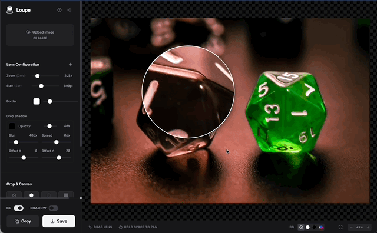
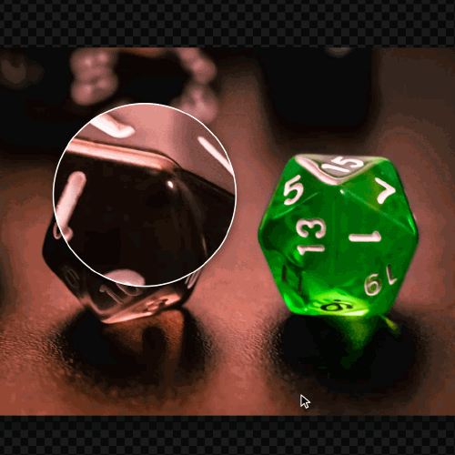
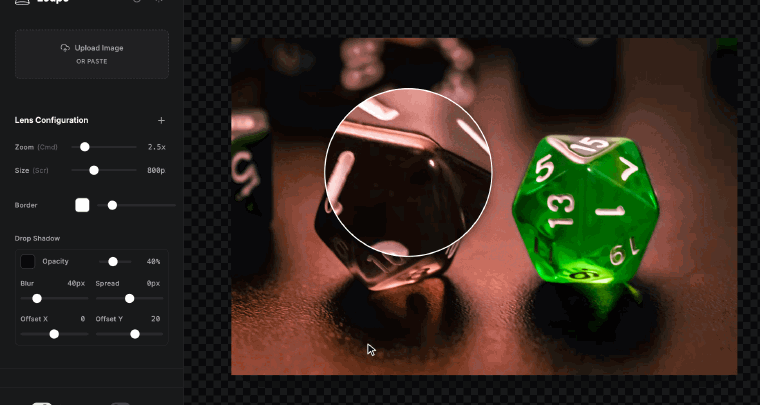
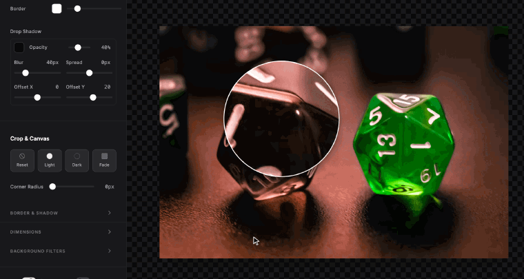

# `loupe`

Magnify the detail that matters in any screenshot. Paste it in, drop a lens on it, and copy the result straight into your slides.

  
[<kbd> haaans.com/loupe  </kbd>](https://haaans.com/loupe/)

## Features

<table>
<tr valign="top">
<td width="50%">
<h3>Drag the lens anywhere</h3>

Grab the lens and slide it over whatever you want people to see. The magnified view follows live.

</td>
<td width="50%">

</td>
</tr>
<tr valign="top">
<td width="50%">

</td>
<td width="50%">
<h3>Scroll to size it, ⌘-scroll to zoom</h3>

Scroll over the lens to make it bigger or smaller. Hold ⌘ and scroll to zoom in closer.

</td>
</tr>
<tr valign="top">
<td width="50%">
<h3>Add as many lenses as you need</h3>

The + adds another lens, each with its own size, zoom, border and shadow.

</td>
<td width="50%">

</td>
</tr>
<tr valign="top">
<td width="50%">

</td>
<td width="50%">
<h3>Pull focus to the lens</h3>

Fade, darken or lighten everything around the lens so the detail stands out. When it looks right, Copy puts it on your clipboard.

</td>
</tr>
</table>
